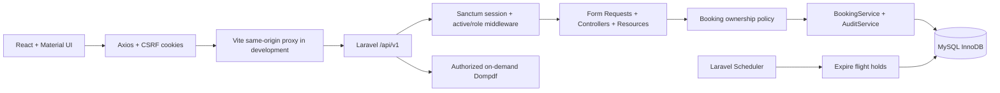

# Architecture

TravelEase is a separate React SPA (`travelease-frontend/`) and Laravel 13 REST API (`laravel source/`) backed by MySQL 8.4 InnoDB. Existing source paths were kept instead of recreating the Laravel project. Every reservation and payment is a simulation.

## Authentication

Axios first calls `/sanctum/csrf-cookie`, then sends session cookies and the XSRF header on writes. Session credentials are never stored in localStorage. Sanctum stateful origins and CORS origins are explicit. Session data resides in MySQL; the cookie is HttpOnly with SameSite=Lax. `SESSION_SECURE_COOKIE=false` is for loopback HTTP only; production requires HTTPS/secure cookies. Theme preference is the only persisted UI account preference in localStorage.

Public registration cannot set roles or status. Active/role middleware protects each portal. BookingPolicy permits owners (or admins for viewing) and owners for cancellation. Wallet/loyalty/notification/client queries are scoped to the authenticated actor. Public flight search is read-only.

## Booking transaction

`BookingService` serializes writes for an actor with a user row lock. Holds and confirmation lock flight classes/holds/seats in deterministic order. Only currently unbooked, unexpired/unheld seats can be held. Confirmation checks owner/expiry/passenger count, recalculates integer-cent fares, locks wallet/loyalty, stores a snapshot, assigns seats, writes payment/ledger/history/audit/notification records, and consumes the hold in one transaction with bounded deadlock retries.

Idempotency records have a unique actor/scope/key constraint, payload hash and stored result. Identical retries replay a result; changed payloads return 409. Failed simulated payments persist one failed attempt/message and do not create a booking or debit. Temporary holds remain available for a safe retry until expiry.

Cancellation snapshots the policy at purchase, locks the actor/booking/inventory/accounts, restores seats, posts one refund credit, reverses earned points, and writes history/audit/notification records atomically. Old seat/passenger/payment snapshots remain readable. There is no external payment provider.

## Side effects and background work

Current notifications are database records written atomically with the business operation; they are not external mail/queue calls before commit. PDFs are generated only on an authorized later request, outside confirmation, so generation failure cannot undo a confirmed reservation. This implementation does not yet use an outbox/queued reminders. Password reset uses Laravel Notifications and the configured mail driver (private log locally).

`travel:expire-holds` runs every minute through Laravel Scheduler. Availability also ignores expired holds immediately, so a stopped scheduler does not sell already-booked seats or indefinitely hide expired seats. `scripts/dev.sh` starts the scheduler with the development servers.

## Frontend structure

Auth/theme context, centralized Axios, a reusable data hook with stale-response protection, loading/error/empty components, public/dashboard layouts, role guards, role dashboards, account screens and flight/booking/management pages. Route modules are lazy loaded; data is fetched from actual APIs. Charts show backend aggregates. Unimplemented domains are described as unavailable rather than replaced with fake data.

## Deployment boundary

Local development is verified; production hosting is not configured. A production frontend needs SPA history fallback and a same-site API origin or reverse proxy. Vite's development proxy is not shipped in the static bundle. Deploy Laravel/PHP, MySQL, scheduler and any future workers separately with secure credentials, HTTPS, backups and configured mail. The Sites hosting runtime is not being used to replace the required Laravel/MySQL stack.
