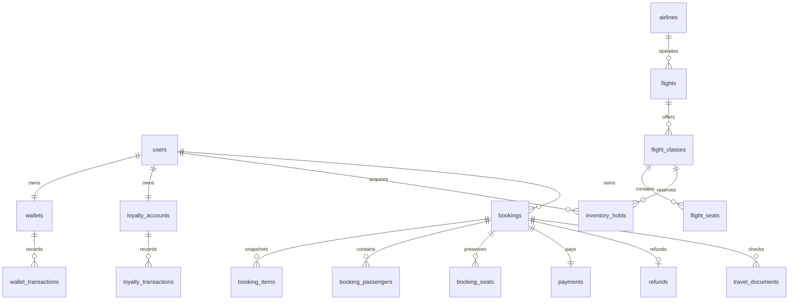

# Database design

Verified locally: **35 InnoDB tables, 34 foreign keys** (including existing/framework tables). Applied migrations are additive; the earlier SQLite file and legacy `accounts` migration were retained. Currency is USD, stored as integer minor units. All domain dates are stored/returned in UTC; UI labels explicitly show UTC.

Emails, airline codes, flight numbers, hold/booking/payment/wallet/refund references, per-class seat labels, actor/scope/idempotency keys, and booking/type loyalty awards are unique. Financial and historical resources use restrictive foreign keys. Inventory is deactivated instead of deleted through the API.

`flight_seats.booking_id` identifies current consumption. `inventory_hold_id` identifies temporary selection. `booking_seats` preserves the historical association after cancellation; the current seat assignment is cleared to allow a subsequent booking. Class and seat locks enforce exclusivity; cancellation never deletes payment/ledger history.

`booking_items.snapshot` freezes flight/airline/class/schedule details and per-unit amounts. `bookings.cancellation_policy` freezes the deadline/fee policy. Flight modification/deactivation is blocked when **any** class has a current booking or active hold. Capacity resizing and advanced class management are not implemented.

`wallet_transactions` stores a signed amount and unsigned post-transaction balance, with no public edit/delete API. MySQL unsigned balances/counts prohibit negative storage; services additionally validate all changes under locks. `refunds.booking_id` and payment reference association are unique; duplicate cancellations return the existing result. Mock declines are recorded separately in `payment_attempts`.

`corporate_clients.agent_id` restricts agent access; `agent_commissions` currently only supports recorded summary values, not automated earning or payouts. `notifications` is Laravel's standard database notification table. Audit logs are read-only to admins. `contact_messages` stores validated local contact requests.

Required hotel/package/promotion/group/fraud/settings schemas remain absent; see the [checklist](requirements-checklist.md). A full assignment ERD cannot honestly be presented as complete yet.
